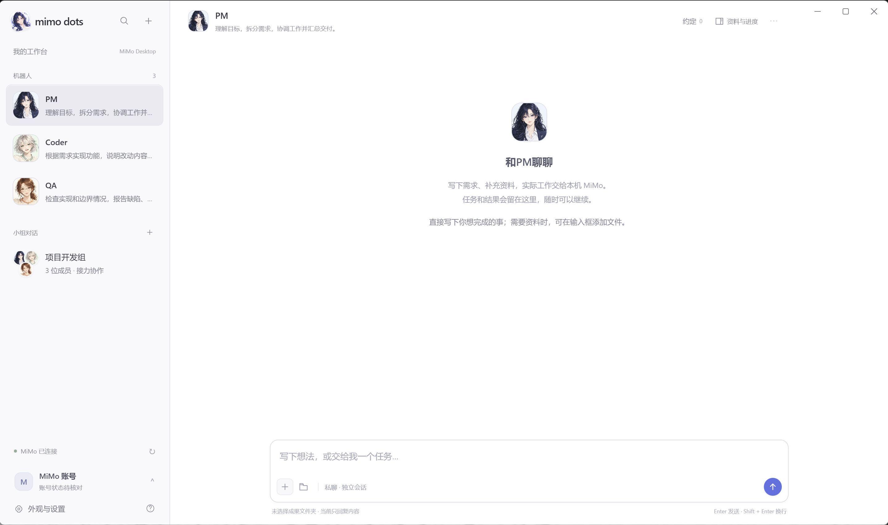

# MiMo Dots

> An independent desktop workbench that uses your locally installed Xiaomi MiMo Desktop to run AI tasks.

[中文说明](README.zh.md)

## About this project

**MiMo Dots is a MiMo Desktop-focused derivative developed from the open-source [Fei2411/DeepSeek-Bot](https://github.com/Fei2411/DeepSeek-Bot) project.** It is maintained as a separate application and is not an official release of the upstream project or Xiaomi. The MiMo Desktop integration and standalone workbench were adapted for this project; the DSH runtime is not included.

MiMo Dots is not affiliated with or endorsed by Xiaomi. It does not include Xiaomi MiMo proprietary source code or assets.

## Features

- Chat with multiple role-based Bots and organize Bots into groups.
- Create and bind dedicated MiMo Desktop conversations to Bots and group members.
- Keep task records, group memories, and conversation bindings in local app data.
- Use built-in anime-style avatars or choose a local image.
- View the account name and login state exposed by the local MiMo Desktop UI. Account status is read at runtime and kept in memory; the app does not bundle your account name or MiMo credentials. Remaining usage is not currently available from MiMo Desktop.

## Preview



## Download

Visit [Releases](https://github.com/jobking2006/mimo-dots/releases) for the Windows stable installer and the separate macOS arm64 prerelease. See [macOS installation and limitations](docs/MACOS.md). Windows may warn that the publisher is unknown because the installer is not code-signed yet.

## Requirements

- Windows x64, or macOS on Apple Silicon (arm64 prerelease)
- Node.js 22.12 or later
- Xiaomi MiMo Desktop installed and signed in

## Run from source

```powershell
npm ci
npm start
```

Create an installer for the host platform with:

```powershell
npm run dist
```

The app reads the local MiMo Desktop API descriptor at runtime to connect to your own MiMo installation. It does not ship a shared API key or model-provider credential. Do not publish your local app-data directory, production screenshots, or personal test logs.

## License and attribution

This derivative is distributed under the Apache License 2.0. See [LICENSE](LICENSE) and [NOTICE](NOTICE) for license terms and attribution to the upstream project.
